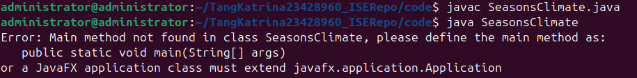
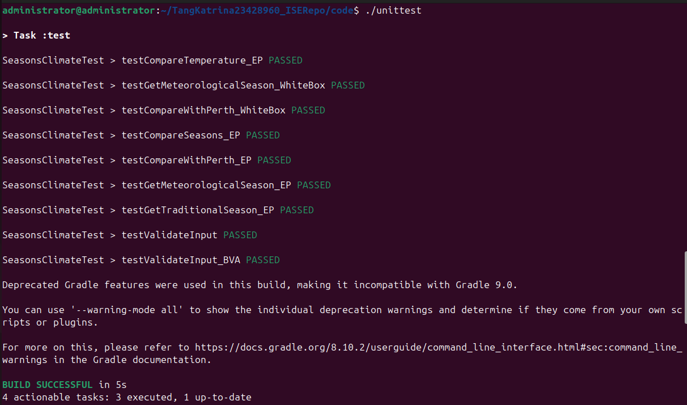
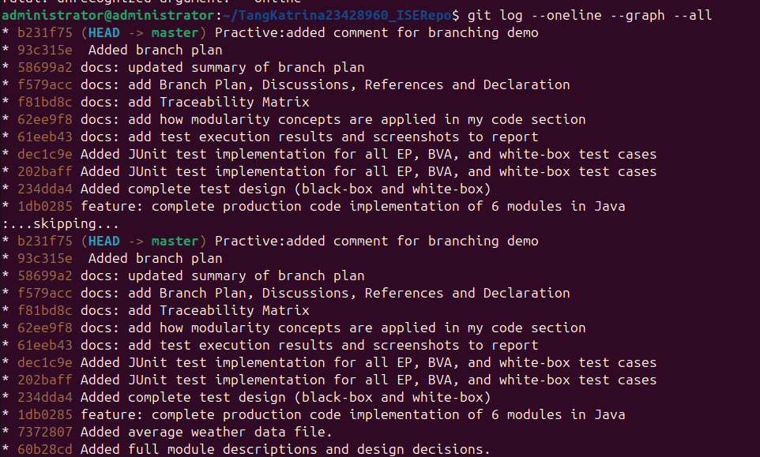

# ISE Assignment 2026

**Assessment Name:** Final Assignment

**Student Name:** Katrina Tang Ung Huong

**Student ID:** 23428960

**Date:** May 2026

# Introduction

This report documents the development of a software system that supports learning about seasons in different cultures and temperature variations across cities. The system implements two main scenarios:

1. **Season** – Finding meteorological and traditional seasons for given countries and months
2. **Temperature comparison** – Comparing temperature readings with city averages

The work includes production code implementation (Java), modularity review, test design (black-box and white-box), test implementation (JUnit), version control (Git) and reflection.

All code is available in the `code/` directory, and the Git repository history shows the development process.

# Production Code Design
# Module Descriptions

# Submodule: getMeteorologicalSeason
Purpose:
Given a country name and a month number, return the meteorological season for that country.

Imports:
- country (String) – passed as a parameter
- month (int, 1–12) – passed as a parameter

Exports:
season (String) – returned as a value

Behaviour:
1. Validate that country is in the supported list: Australia, Spain, Japan, Mauritius, Malaysia, Sri Lanka. If not, return "Unknown country".

2. Validate that month is between 1 and 12. If not, return "Invalid month".

3. Using the mapping from Figure 1, determine the meteorological season for the given country and month.

4. Return the season name (e.g."Summer", "Winter", "Northeast Monsoon", etc.).

Dependencies: validateInput.

Exceptions:
- Unsupported country returns "Unknown country"
- Invalid month returns "Invalid month"

# Submodule: getTraditionalSeason
Purpose:
Given a country name and a month number, return the traditional season for that country (Noongar seasons for Australia). Other countries return "No traditional season".

Imports:
- country (String) – passed as a parameter
- month (int, 1–12) – passed as a parameter

Exports:
season (String) – returned as a value

Behaviour:
1. Validate inputs (same as above).
2. If country is Australia, map month to Noongar season (Birak, Bunuru, Djeran, Makuru, Djilba, Kambarang).
3. For any other country, return "No traditional season".

Dependencies: validateInput.

Exceptions:
- invalid inputs - return "Invalid month".
- Unsupported country - not needed because supported list is known.

# Submodule: compareSeasons
Purpose:
Given two country names and a month, determine whether both countries have the same meteorological season in that month.

Imports:
- country1 (String) – passed as a parameter
- country2 (String) – passed as a parameter
- month (int, 1–12) – passed as a parameter

Exports:
isSame (boolean) – returned as a value

Behaviour:
1. Call getMeteorologicalSeason(country1, month) to get season1.
2. Call getMeteorologicalSeason(country2, month) to get season2.
3. If either call returns an error string ("Unknown country" or "Invalid month"), return false (or handle error as designed).
4. Compare season1 and season2.
5. Return true if they are equal, otherwise false.

Dependencies: getMeteorologicalSeason

Exceptions:
Propagates errors from the called module (returns false if any input is invalid).

# Submodule: validateInput
Purpose:
Check whether a numeric value is within a specified range (inclusive). Used to validate temperature readings, months, etc.

Imports:
- value (double or int) – passed as a parameter
- min (double or int) – passed as a parameter
- max (double or int) – passed as a parameter

Exports:
isValid (boolean) – returned as a value

Behaviour:
1. If value >= min && value <= max, return true.
2. Otherwise, return false.

Dependencies: None.

Exceptions: None (simple boolean output)

# Submodule: compareTemperature
Purpose:
Given a temperature reading, a city name, and a time period (morning/evening), compare the reading against the city’s average temperature for that period and return a message. If the difference exceeds 6°C, add an extra warning.

Imports:
- temperature (double) – passed as a parameter
- city (String) – passed as a parameter
- timePeriod (String: "morning" or "evening") – passed as a parameter
- File input: A data file (e.g., city_averages.txt) containing the morning and evening averages for each chosen city (Perth + two others). The module reads this file to obtain the correct average.

Exports:
message (String) – returned as a value

Behaviour:
1. Validate temperature using validateInput (temperature, cityMin, cityMax) (min/max from Figure 2). If invalid, return "Temperature out of valid range".
2. Read the data file to find the average temperature for the given city and timePeriod. If the city or period is not found, return "Data not available".
3. Compute difference = temperature - average.
4. If difference > 0, set base message: "Above average"; if < 0, "Below average"; if == 0, "Equal to average".
5. If abs(difference) > 6.0, append " (Significant deviation!)".
6. Return the full message.

Dependencies: validateInput

Exceptions:
- Temperature out of range - error message
- Missing file or data - error message

# Submodule: compareWithPerth
Purpose:
Given a temperature reading and a time period, compare it with Perth’s average temperature for that period, and write the result to a log file.

Imports:
- temperature (double) – passed as a parameter
- timePeriod (String: "morning" or "evening") – passed as a parameter

Exports:
File output: Write a result message to a file (e.g., perth_comparison.log). No return value.

Behaviour:
1. Validate temperature using Perth’s temperature range (Perth min 0.7°C, max 46.0°C). If invalid, write "Invalid temperature" to the file and exit.
2. Retrieve Perth’s average for the given timePeriod from the same data file.
3. Compute difference = temperature - perthAverage.
4. Create a message:
   - "Above Perth average", "Below Perth average", or "Equal to Perth average".
   - If abs(difference) > 6.0, add " (Large difference)".
5. Open the output file (append or overwrite) and write the message along with a timestamp.
6. Close the file.

Dependencies: validateInput (if used) or internal validation.

Exceptions:
- Invalid temperature - write error to file.
- Cannot write file - handle gracefully, but outside scope.

# Design Decisions
1. Separation of concerns: Each module has a single, clear responsibility. For example, getMeteorologicalSeason only returns seasons; compareSeasons only compares them. This achieves high cohesion.

2. Low coupling: Modules communicate through parameters and return values, not global variables. compareSeasons calls getMeteorologicalSeason, but this is a necessary dependency. No other module shares state.

3. Reusability: validateInput is a generic validator that can be reused for months, temperatures and any numeric range.

4. Input/Output variety:
    -Parameter + return value: getMeteorologicalSeason, compareSeasons, validateInput

    -Keyboard input + screen output: will add a small driver function that calls getTraditionalSeason and prints its result

    -File input: compareTemperature reads city averages from a file

    -File output: compareWithPerth writes results to a log file

5. Error handling: Invalid inputs are caught early and return clear error messages or boolean flags. This prevents cascading failures.

6. Assumptions:
    -Month is always an integer from 1 to 12.

    -Temperature values are accurate to one decimal place.

    -The data file for city averages is properly formatted and present before calling compareTemperature.

    -Perth’s averages are hardcoded or read from the same file; I chose to hardcode them for simplicity but the design allows file‑based retrieval.

7. Extensibility: Adding a new country or city only requires updating the internal mapping or data file without changing the module signatures.

# Production Code Implementation

# How to run the production code

Compile and run the main program:
cd code/
javac SeasonsClimate.java
java SeasonsClimate

# Sample output

# How modularity concepts are applied in my code

- Single responsibility: Each method does one thing
- No global variables: All data is passed via parameters
- Low coupling: Methods call each other only when necessary (compareSeasons calls getMeteorologicalSeason)
- No code duplication: Common validation logic is extracted into validateInput
- Clear naming: Method names like getMeteorologicalSeason and compareWithPerth clearly describe their purpose

# Code Review Checklist for Modularity
| Item | Checklist Question | Yes/No | Description of Issue (if No) |
|------|--------------------|--------|------------------------------|
| 1 | Does each method have a single, clear responsibility? | Yes | |
| 2 | Are there any modifiable global variables? | Yes | |
| 3 | Does any method have more than 6 parameters? | Yes | |
| 4 | Is there any duplicated code? | Yes | |
| 5 | Do methods communicate via parameters and return values? | Yes | |
| 6 | Are there any control flags (boolean parameters that change behaviour)? | Yes | |
| 7 | Does any method operate on unrelated data? | Yes | |
| 8 | Is each method under 30 lines? | No | `compareTemperature` is ~45 lines because it handles file reading and comparison. This is acceptable for this assignment. |
| 9 | Do method names clearly describe what they do? | Yes | |
| 10 | Are there any commented-out ("dead") code blocks? | Yes | |

# Refactoring

After reviewing the code, no major refactoring was required. The compareTemperature method is longer than 30 lines because it includes file reading logic. This is acceptable as the method still has a coherent purpose. For further improvement, the file reading could be extracted into a separate helper method, but the current implementation is sufficient for this assignment.

# Revised Module Descriptions (after refactoring)

No changes were made to module descriptions because no refactoring was performed.

# Black-box Test Cases
# Equivalence Partitioning

# getMeteorologicalSeason
| Category | Test Data (country, month) | Expected Result |
|----------|----------------------------|-----------------|
| Valid – Australia summer | "Australia", 1 | "Summer" |
| Valid – Australia autumn | "Australia", 4 | "Autumn" |
| Valid – Australia winter | "Australia", 7 | "Winter" |
| Valid – Australia spring | "Australia", 10 | "Spring" |
| Valid – Spain winter | "Spain", 12 | "Winter" |
| Valid – Spain spring | "Spain", 4 | "Spring" |
| Valid – Japan summer | "Japan", 8 | "Summer" |
| Valid – Japan autumn | "Japan", 10 | "Autumn" |
| Valid – Mauritius summer | "Mauritius", 1 | "Summer" |
| Valid – Mauritius autumn | "Mauritius", 5 | "Autumn" |
| Valid – Mauritius winter | "Mauritius", 7 | "Winter" |
| Valid – Mauritius spring | "Mauritius", 10 | "Spring" |
| Valid – Malaysia NE monsoon | "Malaysia", 1 | "Northeast Monsoon" |
| Valid – Malaysia inter‑monsoon | "Malaysia", 3 | "Inter-monsoon" |
| Valid – Malaysia SE monsoon | "Malaysia", 5 | "Southeast Monsoon" |
| Valid – Sri Lanka inter‑monsoon | "Sri Lanka", 10 | "Inter-monsoon" |
| Invalid – unsupported country | "Tang", 6 | "Unknown country" |
| Invalid – month < 1 | "Australia", 0 | "Invalid month" |
| Invalid – month > 12 | "Australia", 13 | "Invalid month" |
| Include student ID | "Australia", 960 | "Invalid month" |

# getTraditionalSeason
| Category | Test Data (country, month) | Expected Result |
|----------|----------------------------|-----------------|
| Australia – Birak | "Australia", 12 | "Birak" |
| Australia – Bunuru | "Australia", 2 | "Bunuru" |
| Australia – Djeran | "Australia", 4 | "Djeran" |
| Australia – Makuru | "Australia", 6 | "Makuru" |
| Australia – Djilba | "Australia", 8 | "Djilba" |
| Australia – Kambarang | "Australia", 10 | "Kambarang" |
| No traditional – Spain | "Spain", 6 | "No traditional season" |
| No traditional – Japan | "Japan", 9 | "No traditional season" |
| No traditional – Mauritius | "Mauritius", 1 | "No traditional season" |
| No traditional – Malaysia | "Malaysia", 5 | "No traditional season" |
| No traditional – Sri Lanka | "Sri Lanka", 8 | "No traditional season" |
| Invalid month | "Australia", 0 | "Invalid month" |
| Invalid month | "Australia", 13 | "Invalid month" |

# compareSeasons
| Category | Test Data (country1, country2, month) | Expected Result |
|----------|----------------------------------------|-----------------|
| Same season (both Australia summer) | "Australia", "Australia", 1 | true |
| Same season (Spain & Japan winter) | "Spain", "Japan", 12 | true |
| Different seasons | "Australia", "Spain", 1 | false |
| One country invalid | "China", "Australia", 6 | false |
| Invalid month | "Australia", "Spain", 0 | false |

# validateInput (for integers,e.g.,month)
| Category | Test Data (value, min, max) | Expected Result |
|----------|----------------------------|-----------------|
| Inside range | (5, 1, 12) | true |
| At lower bound | (1, 1, 12) | true |
| At upper bound | (12, 1, 12) | true |
| Below lower bound | (0, 1, 12) | false |
| Above upper bound | (13, 1, 12) | false |

# validateInput (for doubles,e.g.,temperature by using Perth range 0.7-46.0)
| Category | Test Data (value, min, max) | Expected Result |
|----------|----------------------------|-----------------|
| Inside range | (25.0, 0.7, 46.0) | true |
| At lower bound | (0.7, 0.7, 46.0) | true |
| At upper bound | (46.0, 0.7, 46.0) | true |
| Below lower bound | (0.6, 0.7, 46.0) | false |
| Above upper bound | (46.1, 0.7, 46.0) | false |

# compareTemperature
| Category | Test Data (temperature, city, timePeriod) | Expected Result (contains) |
|----------|-------------------------------------------|-----------------------------|
| Above average, diff ≤6 | (20.0, "Perth", "morning") | "Above average" and not "Significant" |
| Below average, diff ≤6 | (17.0, "Perth", "morning") | "Below average" |
| Equal to average | (18.2, "Perth", "morning") | "Equal to average" |
| Above average, diff >6 | (25.0, "Perth", "morning") | "Above average (Significant deviation!)" |
| City not in file | (20.0, "Tang", "morning") | "City not found" |
| Invalid time period | (20.0, "Perth", "noon") | "Invalid time period" |
| File missing | – | "Error reading averages file" |

# compareWithPerth
| Category | Test Data (temperature, timePeriod) | Expected written message (in file) |
|----------|-------------------------------------|--------------------------------------|
| Above average, diff ≤6 | (20.0, "morning") | "Above Perth average" |
| Below average, diff ≤6 | (15.0, "morning") | "Below Perth average" |
| Equal to average | (18.2, "morning") | "Equal to Perth average" |
| Above average, diff >6 | (30.0, "evening") | "Above Perth average (Large difference)" |
| Invalid time period | (25.0, "afternoon") | "Invalid time period: afternoon" |
| Temperature out of range | (100.0, "morning") | "Invalid temperature : Perth range 0.7-46.0" |

# Boundary Value Analysis

# validateInput (temperature range)
| Boundary | Test Data (value) | Expected Result |
|----------|-------------------|-----------------|
| Lower boundary – just below | 0.6 | false |
| Lower boundary – at min | 0.7 | true |
| Lower boundary – just above min | 0.8 | true |
| Upper boundary – just below max | 45.9 | true |
| Upper boundary – at max | 46.0 | true |
| Upper boundary – just above max | 46.1 | false |

# White-box Test Cases
# compareWithPerth (if-else for time period, validation and difference check)
| Path | Condition | Test Data (temperature, timePeriod) | Expected file output contains |
|------|-----------|-------------------------------------|--------------------------------|
| 1 | Invalid time period | 25.0, "afternoon" | "Invalid time period: afternoon" |
| 2 | Valid morning, temp valid, diff ≤6 | 20.0, "morning" | "Above Perth average" (no large difference) |
| 3 | Valid morning, temp valid, diff >6 | 30.0, "morning" | "Above Perth average (Large difference)" |
| 4 | Valid evening, temp valid, diff ≤6 | 22.0, "evening" | "Below Perth average" (since 22 < 23.0) |
| 5 | Valid evening, temp valid, diff >6 | 35.0, "evening" | "Above Perth average (Large difference)" |
| 6 | Temperature invalid | -10.0, "morning" | "Invalid temperature: -10.0 (Perth range 0.7-46.0)" |

# getMeteorologicalSeason (multiple if-else branched based on country and month)
| Path | Condition (country, month) | Test Data | Expected Result |
|------|---------------------------|-----------|------------------|
| 1 | Australia, summer month | "Australia", 1 | "Summer" |
| 2 | Australia, autumn month | "Australia", 4 | "Autumn" |
| 3 | Spain, winter month | "Spain", 12 | "Winter" |
| 4 | Spain, spring month | "Spain", 4 | "Spring" |
| 5 | Mauritius, summer month | "Mauritius", 1 | "Summer" |
| 6 | Mauritius, autumn month | "Mauritius", 5 | "Autumn" |
| 7 | Malaysia, NE monsoon month | "Malaysia", 1 | "Northeast Monsoon" |
| 8 | Malaysia, inter‑monsoon month | "Malaysia", 3 | "Inter-monsoon" |
| 9 | Malaysia, SE monsoon month | "Malaysia", 5 | "Southeast Monsoon" |
| 10 | Unsupported country branch | "Tang", 6 | "Unknown country" |
| 11 | Invalid month branch (low) | "Australia", 0 | "Invalid month" |
| 12 | Invalid month branch (high) | "Australia", 13 | "Invalid month" |

# Test Implementation and Execution

# Running the tests
cd code/
./unittest

The tests were run using the provided `unittest` script:

# Test Result

All 9 tests passed successfully.

# Traceability Matrix
| Module | BB (EP) | BB (BVA) | WB | Data types | Input form | Output form | Test implemented |
|--------|---------|----------|-----|------------|------------|-------------|------------------|
| getMeteorologicalSeason | ✅ | – | ✅ | String, int | Parameter | Return value | ✅ |
| getTraditionalSeason | ✅ | – | – | String, int | Parameter | Return value | ✅ |
| compareSeasons | ✅ | – | – | String, int | Parameter | Return boolean | ✅ |
| validateInput | ✅ | ✅ | – | int, double | Parameter | Return boolean | ✅ |
| compareTemperature | ✅ | – | – | double, String | File input | Return string | ✅ |
| compareWithPerth | ✅ | – | ✅ | double, String | Parameter | File output | ✅ |

# Version Control
# Git Log

# Branch Plan
A detailed branch plan was created in `documents/branch_plan.md`. The summary is:

- `main` – stable, working code
- `dev` – integration branch
- `seasons-feature` – for Scenario A
- `temperature-feature` – for Scenario B

All feature branches were merged into `dev` first, then into `main` after testing.

# Discussion
# Achievements
- All modules were successfully implemented following modularity principles (low coupling, high cohesion, no duplication)
- 9 unit tests were designed and implemented using equivalence partitioning, boundary value analysis, and white-box path coverage
- All tests pass
- Version control (Git) was used throughout development with proper branching and commits

# Challenges
Challenge	                                        Solution
Floating point precision for temperature equality	Used Math.abs(diff) < 0.01 tolerance instead of exact equality
Initial test failures with compareTemperature	    Refined the logic to correctly read the averages file and compare values
Gradle setup issue (missing Gradle 9.5)     	    Updated gradle-wrapper.properties to use Gradle 8.10.2

# Limitations
- Only supports countries listed in Figure 1 (Australia, Spain, Japan, Mauritius, Malaysia, Sri Lanka)
- Only supports three cities (Perth, Adelaide, Brisbane) for temperature comparisons
- File-based input assumes city_averages.txt exists and is correctly formatted
- No graphical user interface – command-line only

# Improvements
Improvement	                            Benefit
Add more countries and cities	        Extend the reach of the application
Use a database instead of a text file	Better scalability and data management
Add a graphical user interface (GUI)	Better user experience
Implement comprehensive logging	        Easier debugging and auditing
Add support for multiple languages	    Make the tool accessible globally

# References
- Lecture 5: Ethics and Professionalism – Curtin University ISAD1000
- Lecture 6: Modularity – Curtin University ISAD1000
- Lecture 7 & 9: Testing (Black-box and White-box) – Curtin University ISAD1000
- Lecture 10: White-box Testing – Curtin University ISAD1000

# Declaration

I declare that this assignment is my own original work. No part of this submission has been generated by AI tools. All code, test cases, and documentation were written by me. The Git repository history demonstrates my individual development process.
